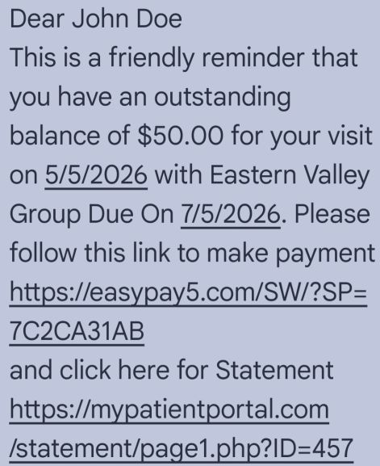
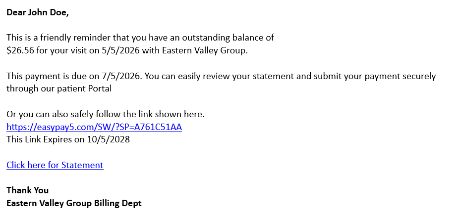

# Message Pay

One of our most popular features enables you to generate payment links on demand through the API and deliver them directly to cardholders via SMS or email.  Our newest revision of this feature is called “Message Pay’.&#x20;

The API call needed to invoke this activity is shown here:->  [Msg Pay](../../../api-reference/rest-api/message-pay.md)&#x20;

This feature combines our ultra flexible [PayForm](https://docs.number.tech/documentation/getting-started/integration-options/payform) feature with a messaging system such as SMS or EMAIL. &#x20;

The PayForm component allows you to design the actual cardholder data collection format in advance. You may be targeting a specific cardholder who owes a specific amount, or you may simply want to collect funds in more general terms. &#x20;

Before diving into the Message Pay feature, we encourage you to first get acquainted with the [PayForm](https://docs.number.tech/documentation/getting-started/integration-options/payform) feature, as this is the main component of Message Pay. Before you can deliver the payment link you will first design the Form which collects the payment.&#x20;

With a single API call, you can define the following:

1. The number of fields on the form&#x20;
2. &#x20;Initial prepopulated data with Read-Only or editable attributes  &#x20;
3. The behavior and submission options of the form&#x20;
4. The style / appearance of the form &#x20;
5. The specific messaging aspects for Email or SMS &#x20;

The API call will return a URL which is sent via SMS/EMAIL along with a custom message to the intended recipient. &#x20;

If you are trying to collect a specific statement invoice you can also define and communicate the due date and link expiration date to the recipient.&#x20;

The standard Message Pay URL will be available for up to 3 months. After this period the generated URL will no longer be active. &#x20;

***

### Field Descriptions&#x20;

If you inspect the Json Request for this API call [HERE](https://app.gitbook.com/o/BBeFXc7fqAfKkKCdsmTJ/sites/site_o8JDg/s/4UWkWFnnmVPzvJTdMtC0/~/edit/~/changes/965/api-reference/rest-api/message-pay#sample-request), you will notice it is comprised of two parent objects &#x20;

1. Message parameters ( MsgParams ) &#x20;
2. PayForm parameters  ( InitParams) &#x20;

#### Message Parameters  (R = Required , O = Optional)&#x20;

* MessageType :  \[R] use  EMAIL, SMS or URLONLY
* MessageBody : \[O] Here you can define a message to accompany your payment link
* DueOn :  \[O] You can provide a payment due date within your message
* ExpiresOn :  \[R] You must supply a date with which the link will expire. 3 months maximum
* SingleUsage : \[R] Set value 1 if you expect a single payment for a specific statement amount. Set Value 0 if the URL provided can collect multiple payents &#x20;

#### PayForm Parameters  (R = Required , O = Optional)

* MerchID: \[R]  integer value pointing to a merchant record within the Account
* WTYPE:  \[O] (not required)
* PostURL: \[O] depending on your PayForm submission options (see eSubmission), we can send data to the URL of your choice after payment is authorized
* RedirectURL: \[O] depending on your PayForm submission options ( see eSubmission), we can redirect to a specific page once a transaction has been completed
* REF\_ID : \[O] this is a user defined field which you may want to tie to the final transaction
* RPGUID: \[O] this is a user defined field which you may want to tie to the final transaction
* EndPoint: \[R] this is determined by NUMBER (Use PF initially)
* EINDEX: \[O] Placing an integer here will force encryption when we send you submission data ( use 300 for sandbox Key)
* Amount: \[R] Required Amounts
* Surcharge: \[R] Required Amounts
* TotalAmt: \[R] Required Amounts
* Firstname: \[O]  for prepopulating data on the PayForm
* Lastname: \[O]  for prepopulating data on the PayForm
* StreetAddress: \[O]  for prepopulating data on the PayForm
* City:  \[O]  for prepopulating data on the PayForm
* State: \[O]  for prepopulating data on the PayForm
* ZIP"  \[O]  for prepopulating data on the PayForm
* Country: \[O]  for prepopulating data on the PayForm
* Email: \[O] this is required if choosing the EMAIL option&#x20;
* Phone: O] this is required if choosing the SMSL option
* Company: \[O] for prepopulating data on the PayForm
* eVisible: \[R] These are required Configuration settings: see PayForm
* eReadOnly:  \[R] These are required Configuration settings: see PayForm
* eStyles:  \[R] These are required Configuration settings : see PayForm
* eSubmission:  \[R] These are required Configuration settings : see PayForm
* eFeatures:  \[R] These are required Configuration settings : see PayForm
* eColors:  \[R] These are required Configuration settings : see PayForm  &#x20;

#### Defining your Form&#x20;

In order to develop the PayForm which will be delivered to the Cardholder , you can use a specific tool to develop the options  which are sent in the request. [https://easypay8.com/byowidget/](https://easypay8.com/byowidget/)&#x20;

Due to the vast number of options available we represent them using HEXIDECIMAL VALUES

"WidOptions": {
\
"eVisible": "0665",
\
"eReadOnly": "0040",
\
"eStyles": "0001",
\
"eSubmission": "0A01",
\
"eFeatures": "0000",
\
"eColors": "#ffffff,#428bca,#007bff,#212121,#ffffff,#212121,#ffffff"
\
},

generally you will only be developing these options once, and then you will be using them for your entire campaign of messaging.  Our staff is always happy to assist to ensure you create the features and options which work best for you. &#x20;

#### Sending a Simple TEXT Message ( Use Option TEXT )

Here you can use the _MessageBody Field_ &#x20;

When sending a TEXT/SMS, it is best to keep the message short and sweet. it is for this reason we have a DEFAULT message which you can use by simply leaving this field empty.&#x20;

We will simply pull a few details from your request such as:

MERCHANT NAME, AMOUNT, PAYMENT DUE DATE, LINK EXPIRATION

**The resulting text message will read as Follows**&#x20;

_You have a Payment Due to ( Merchant Name ) of (Amount) due on ( Due Date ) .  Follow the link below to make payment (Payment Link) This Link Expires on ( Exp Date )_&#x20;

If you decide to create your own message we will append the following to your message:

_Follow the link below to make payment (Payment Link) This Link Expires on ( Exp Date )_&#x20;

#### Sending a Custom SMS Message ( Use Option SMS )

For the This Option you must create a custom message. To help create your message we have provided some Variable fields: Please include the "||" characters.&#x20;

* ||Merch1||  when we see this in your message we will replace it with the actual Merchant name
* ||Amt||  when we see this in your message we will replace it with Amount specified
* ||PayLink||  when we see this in your message we will replace it with the payment link
* ||DueOn||  when we see this we will replace it with the Date you specify for payment due date
* ||ExpOn||  when we see this we will replace it with the Date you specify for payment link expiration Date&#x20;

The SMS option does NOT support HTML tags however you can force a Line Break with "\n"

**Adding your own HTML Links**

Here is an example of an Html Link you may wish to insert:

[https://mypatientportal.com/statement/page1.php?ID=457](https://mypatientportal.com/statement/page1.php?ID=457)

In order to insert this into your custom SMS you will need to extract ALL the text and convert to a Byte Array represented as HEXADECIMAL then place between Custom Tag Z as follows \<z....\<z/>&#x20;

for the above example you will end up with the following&#x20;

\<z68747470733A2F2F6D7970617469656E74706F7274616C2E636F6D2F73746174656D656E742F70616765312E7068703F49443D343537\</z>

Here is an example Custom Message for SMS using the variables above

Dear John Doe\nThis is a friendly reminder that you have an outstanding balance of ||Amt|| for your visit on 5/5/2026 with ||Merch1|| Due On ||DueOn||. Please follow this link to make payment ||PayLink||\n and click here for Statement\n\<z68747470733A2F2F6D7970617469656E74706F7274616C2E636F6D2F73746174656D656E742F70616765312E7068703F49443D343537\</z>

**The resulting text message will read as Follows**&#x20;

<figure><figcaption></figcaption></figure>

#### Sending a Custom EMAIL Message&#x20;

For the Email Option you must create a custom message. To help create your message we have provided some Variable fields: Please include the "||" characters.&#x20;

* ||Merch1||  when we see this in your message we will replace it with the actual Merchant name
* ||Amt||  when we see this in your message we will replace it with Amount specified
* ||PayLink||  when we see this in your message we will replace it with the payment link
* ||DueOn||  when we see this we will replace it with the Date you specify for payment due date
* ||ExpOn||  when we see this we will replace it with the Date you specify for payment link expiration Date&#x20;

**Adding your own Anchor tags**&#x20;

Here is an example of an Anchor tag you may wish to insert:

\<a href="https://MypatientPortal.com/Statement/page1.php?ID=457">Click Here for Statement\</a>

In order to insert this into your custom Email you will need to extract ALL the text between the Anchor Tags ( INCLUDING SPACES ) and convert to a Byte Array represented as HEXADECIMAL&#x20;

for the above example you will end up with the following&#x20;

\<a20687265663D2268747470733A2F2F4D7970617469656E74506F7274616C2E636F6D2F53746174656D656E742F70616765312E7068703F49443D343537223E436C69636B206865726520666F722053746174656D656E74\</a>

&#x20;

Here is an example Custom Message for EMAIL using the variables above

\<b>Dear John Doe,\</b>\ \ This is a friendly reminder that you have an outstanding balance of \  $26.56 for your visit on 5/5/2026 with ||Merch1||. \ \ This payment is due on ||DueOn||. You can easily review your statement and submit your payment securely through our patient Portal \ \ Or you can also safely follow the link shown here.\ ||PayLink||\ This Link Expires on ||ExpOn||\ \ \<a20687265663D2268747470733A2F2F4D7970617469656E74506F7274616C2E636F6D2F53746174656D656E742F70616765312E7068703F49443D343537223E436C69636B206865726520666F722053746174656D656E74\</a>\ \ \<b>Thank You\ ||Merch1|| Billing Dept\</b>

&#x20; Here is the resulting email message:&#x20;

<figure><figcaption></figcaption></figure>
